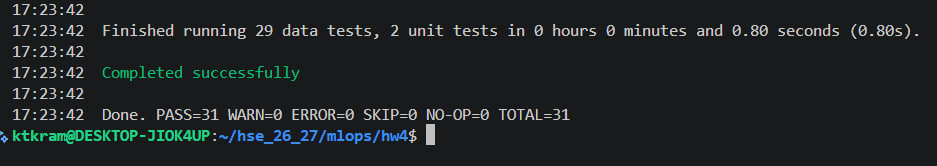
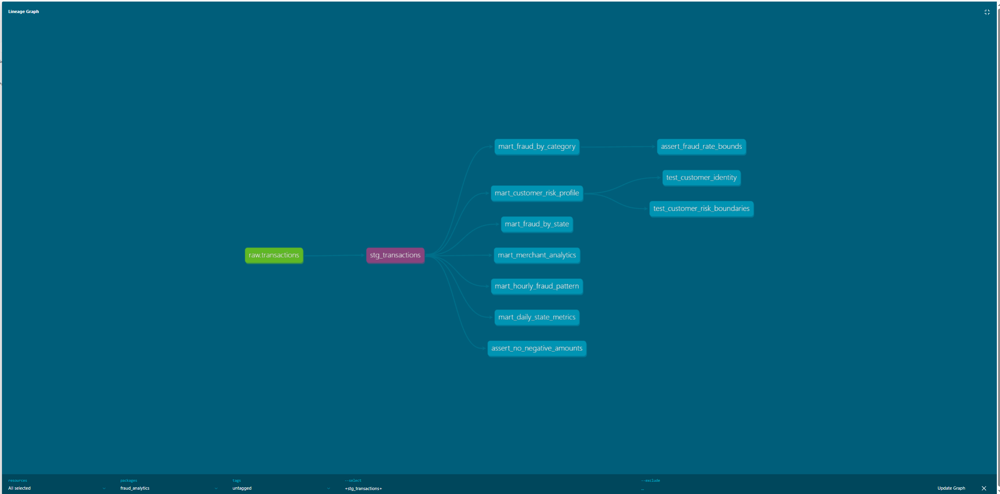

# Домашнее задание 4

Для загрузки данных взят код из hw2. CSV отправляется через Kafka в ClickHouse, дальше dbt строит staging и 6 витрин из задания

Витрины считают метрики по датам и штатам, фрод по категориям и штатам, риск клиентов, временные паттерны и метрики мерчантов. Добавлены макрос amount_bucket, пакеты dbt_utils, dbt_date и dbt_expectations, тесты и описания моделей. Настроены SQLFluff, pre-commit и Makefile.

dbt-core 1.10.23, dbt-clickhouse 1.10.3

## Запуск

Нужны Docker Compose и Make. Датасет из hw2 положить в `data/train.csv`, в репозиторий он не включен. Команды выполнять из корня проекта

```bash
make build
make up
make load
```

`make load` запускать только один раз для новой базы, иначе данные задублируются. Дождаться загрузки всех 786431 строк в `transactions_db.transactions`, затем

```bash
make deps
make run
make test
make lint
make docs
make docs-serve
```

Документация откроется на http://localhost:8082

Прошли все 31 тест, из них 29 проверок данных и 2 unit-теста. Unit-тесты проверяют границы риска и клиентов с одинаковыми именами, singular tests проверяют суммы и fraud_rate




